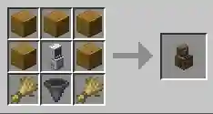
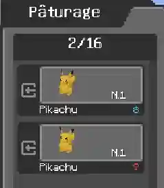
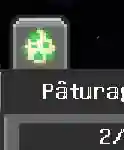
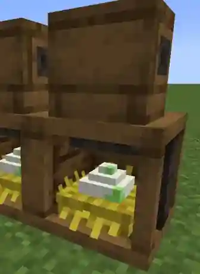
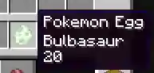

# 🏡 Pastures & Pokémon Eggs



The <strong>Pasture Block</strong> is the heart of Cobbreeding. Use it to let Pokémon roam, activate breeding and collect the eggs they produce.



---

## 🧱 Set Up Your Pasture



### 1. Place the Pasture Block

Obtain a **Pasture Block** from Cobblemon. Place it on suitable terrain with enough free space **behind it**, since that is where selected Pokémon appear.

Use the in-game recipe viewer, when available, to confirm the recipe for your installed modpack version.

*Pasture Block recipe illustrated in the original guide.*


### 2. Open the Interface

Right-click the block. Select the Pokémon you want to place in your pasture from your Pokémon storage.

*Select Pokémon in the Pasture interface. The screenshot uses the original mod UI.*


### 3. Activate Breeding

Look for the **breeding toggle near the top-right corner** of the Pasture interface and turn it on. A newly placed pasture does **not** automatically breed Pokémon.

*The activated breeding icon in the Pasture interface.*


A server can limit how many Pasture Blocks each player may activate for breeding. If activation is refused, check your server's rules or configuration.



### 4. Add Compatible Parents

Place compatible Pokémon together and give them time. They can breed even when they have **different Original Trainers**, as long as the other compatibility rules are met.



---

## 💞 Which Pokémon Can Breed?

| Parent combination | Result |
| --- | --- |
| Opposite genders with at least one shared **Egg Group** | ✅ Compatible in general |
| Genderless Pokémon with **Ditto** | ✅ Compatible unless the species is excluded |
| Species in the **Undiscovered** Egg Group | ❌ Cannot breed, even with Ditto |
| Pokémon without a shared Egg Group and without a valid Ditto pairing | ❌ Not compatible |


**A common misconception:** sharing the same species is not required. **Egg Group compatibility** is what matters. Two Ditto producing random eggs is a separate, optional server setting, not a rule to assume is enabled.


---

## 🥚 Collecting Eggs

When breeding succeeds, eggs appear in the **nesting inventory at the bottom of the Pasture Block**.

*The nesting area is accessible underneath the Pasture Block.*

- **Manual collection:** right-click the bottom of the block.
- **Hopper collection:** can work when the server setting `allowHoppersToPullFromPastureBlock` allows it.
- **Limited storage:** a pasture can hold only its configured number of eggs. Collect them regularly so the nesting inventory does not stay full.


The author notes that some egg collection statistics may require **manual collection** rather than a hopper. For progression tracking, collect eggs by hand when possible.


---

## ⏳ Hatching Your Eggs

Keep the collected egg in your **player inventory** while its hatching timer progresses. Time does not progress normally while it is stored outside a player's inventory, such as in a chest.

The exact hatching duration depends on the Pokémon and active settings. Some Pokémon Abilities can reduce this time.

*An egg item tooltip from the mod author's guide. The timer may differ for your Pokémon.*

### 🔥 Another Option: Egg Incubators

CobbleSafari also features an **Egg Incubator** compatible with Cobbreeding eggs. The dedicated guide explains how to insert eggs and retrieve the resulting Pokémon:

[🥚 Wild Eggs & Incubators](../mods-guides/CobbleSafari/wild_eggs_incubators.md)

---

## 🏡 Build a Safe Breeding Area

Give large Pokémon enough space to appear, and avoid exposed lava, deep water, dangerous blocks and other environmental hazards. Pastured Pokémon can be affected by hazards depending on the mods and protections active in your world.


**Next:** Learn how to pass down traits and use breeding items in [🧬 Inheritance & Shiny Hunting](inheritance-and-shinies.md).


---

## 📖 Source

Adapted from the [official Cobbreeding guide](https://docs.google.com/document/d/1Hk5Iqnzm2NqkXGwzUIvPVFKhAwVHSEM3hyP3Qdhl5g4/edit) and the [official mod description](https://modrinth.com/mod/cobbreeding).


## 📥 Contact Us

If you have questions, suggestions or corrections, join our <a href="https://discord.gg/kb8NSTF45n">Discord</a>. Contact <strong>@FabLeKebab</strong> for wiki-related topics or <strong>@Levels</strong> for modpack-related topics.


