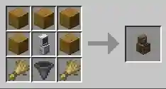
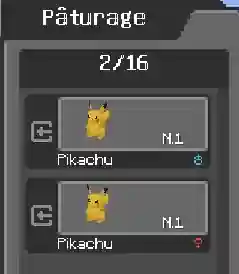
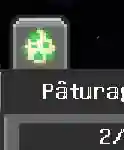
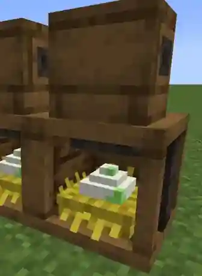
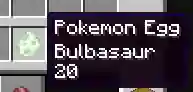

# 🏡 Pâturages et œufs Pokémon



Le <strong>bloc de pâturage (Pasture Block)</strong> est au cœur de Cobbreeding. Il permet de laisser vos Pokémon se promener, d'activer la reproduction et de récolter les œufs.



---

## 🧱 Installer votre pâturage



### 1. Placez un bloc de pâturage

Obtenez un **Pasture Block** de Cobblemon. Installez-le sur un terrain adapté avec assez d'espace libre **derrière le bloc**, là où les Pokémon sélectionnés apparaîtront.

Consultez l'afficheur de recettes du jeu, s'il est disponible, pour confirmer la recette de la version installée du modpack.

*Recette du Pasture Block illustrée dans le guide d'origine.*


### 2. Ouvrez son interface

Faites un clic droit sur le bloc et sélectionnez les Pokémon à placer dans le pâturage depuis votre stockage Pokémon.

*Sélection des Pokémon dans l'interface de pâturage du mod.*


### 3. Activez l'élevage

Repérez le **bouton d'activation près du coin supérieur droit** de l'interface et activez-le. Un nouveau pâturage ne produit **pas** automatiquement des œufs.

*Icône de reproduction activée dans l'interface du pâturage.*


Un serveur peut limiter le nombre de blocs de pâturage actifs pour l'élevage par joueur. Si l'activation est refusée, vérifiez les règles ou la configuration du serveur.



### 4. Ajoutez des parents compatibles

Placez des Pokémon compatibles ensemble et laissez-leur du temps. Ils peuvent se reproduire même s'ils possèdent des **dresseurs d'origine différents**, à condition de respecter les autres règles de compatibilité.



---

## 💞 Quels Pokémon peuvent se reproduire ?

| Association | Résultat |
| --- | --- |
| Sexes opposés et au moins un **groupe d'œufs** commun | ✅ Généralement compatible |
| Pokémon sans sexe avec **Métamorph** | ✅ Compatible si l'espèce n'est pas exclue |
| Espèce appartenant au groupe **Inconnu / Undiscovered** | ❌ Reproduction impossible, même avec Métamorph |
| Aucun groupe commun et aucune association valide avec Métamorph | ❌ Non compatible |


**À retenir :** les parents ne doivent pas forcément être de la même espèce. C'est leur **groupe d'œufs** qui détermine leur compatibilité. La production d'œufs aléatoires à partir de deux Métamorph est une option serveur distincte, qu'il ne faut pas considérer comme activée par défaut.


---

## 🥚 Récolter les œufs

Quand la reproduction réussit, les œufs apparaissent dans **l'inventaire de nidification situé sous le bloc de pâturage**.

*La partie inférieure du bloc donne accès aux œufs.*

- **Collecte manuelle :** faites un clic droit sur la partie inférieure du bloc.
- **Entonnoirs :** ils peuvent collecter les œufs si le paramètre serveur `allowHoppersToPullFromPastureBlock` l'autorise.
- **Stockage limité :** un pâturage ne peut conserver qu'un nombre d'œufs défini par la configuration. Pensez à les récupérer régulièrement.


L'auteur indique que certaines statistiques de collecte des œufs peuvent nécessiter une **récupération manuelle**, plutôt qu'un entonnoir. Pour suivre votre progression, privilégiez le clic droit.


---

## ⏳ Faire éclore les œufs

Conservez l'œuf dans **l'inventaire de votre personnage** pour que son minuteur d'éclosion progresse. Le temps n'avance pas normalement si l'œuf se trouve dans un stockage extérieur, comme un coffre.

La durée dépend de l'espèce et des paramètres actifs. Certains talents Pokémon peuvent la réduire.

*Exemple de l'info-bulle d'un œuf dans le guide officiel. La durée varie selon le Pokémon.*

### 🔥 Autre possibilité : les incubateurs

CobbleSafari propose également un **incubateur d'œufs** compatible avec ceux de Cobbreeding. Le guide dédié explique comment insérer un œuf puis récupérer le Pokémon obtenu :

[🥚 Œufs sauvages et incubateurs](../mods-guides/CobbleSafari/wild_eggs_incubators.md)

---

## 🏡 Sécuriser votre zone d'élevage

Prévoyez suffisamment de place pour les grands Pokémon et évitez lave, eau profonde, blocs dangereux et autres risques environnementaux. Selon les mods et protections actifs dans votre monde, les Pokémon en pâturage peuvent subir des dégâts.


**À suivre :** découvrez la transmission des caractéristiques et les objets d'élevage dans [🧬 Hérédité et Pokémon chromatiques](inheritance-and-shinies.md).


---

## 📖 Source

Adapté du [guide officiel de Cobbreeding](https://docs.google.com/document/d/1Hk5Iqnzm2NqkXGwzUIvPVFKhAwVHSEM3hyP3Qdhl5g4/edit) et de la [description officielle du mod](https://modrinth.com/mod/cobbreeding).


## 📥 Nous contacter

Vous avez une question, une suggestion ou une correction à proposer ? Rejoignez notre <a href="https://discord.gg/kb8NSTF45n">Discord</a>. Contactez <strong>@FabLeKebab</strong> pour le wiki ou <strong>@Levels</strong> pour le modpack.


